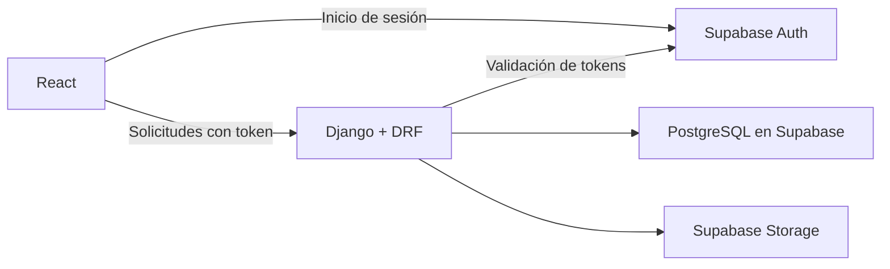

<div align="center">

# 🎁 Mary Detalles

Plataforma web de regalos personalizados.

[Proyecto](#el-proyecto) · [Equipo](#equipo) · [Arquitectura](#arquitectura) · [Instalación](#ejecución-local) · [Documentación](#documentación) · [Recursos](#diseño-y-planificación)

</div>

---

## El proyecto

Mary Detalles busca facilitar la elección de regalos personalizados y conectar a sus clientes con el equipo de ventas. La plataforma reunirá el catálogo de productos, las opciones de personalización y las solicitudes de cotización en un solo lugar.

La primera versión contempla las siguientes funcionalidades.

- **Catálogo público** con categorías, filtros por ocasión, búsqueda por palabras clave, fotografías, precios orientativos y opciones de personalización.
- **Contacto por sucursal** mediante WhatsApp con mensajes prellenados y un formulario de cotización con validación y confirmación de recepción.
- **Área interna** para administradores y vendedores, con permisos diferenciados y gestión de productos por sucursal.
- **Control de operaciones** con aprobación administrativa de cambios de precio, eliminación lógica de productos y registro de las acciones de los usuarios internos.
- **Seguimiento comercial** con estados y observaciones de las solicitudes, además de administración de cuentas y roles.
- **Información del negocio** con productos destacados, ubicaciones, horarios y datos de contacto de ambas sucursales, en una interfaz adaptable a móviles y computadoras.

El precio final, la disponibilidad y la confirmación de pedidos se coordinarán directamente con el negocio. El registro de solicitudes corresponderá a los formularios enviados desde la plataforma. Los pagos electrónicos, el carrito de compras, la facturación electrónica y el inventario avanzado quedan para futuras etapas.

## Equipo

| Materia | Integrantes |
| --- | --- |
| Ingeniería de Software | Maria Fernanda Jovel Betanco |
| Ingeniería de Software | Stiven Alexander Palma |
| Diseño y Gestion Web | Maria Fernanda Lara Alonso |
| Diseño y Gestion Web | Lesthy Alina Loaisiga Lara |

## Tecnologías

| Área | Herramientas |
| --- | --- |
| Frontend | React · JavaScript · HTML · CSS · Vite |
| Backend y API | Python · Django · Django REST Framework (DRF) |
| Base de datos | PostgreSQL en Supabase |
| Autenticación | Supabase Auth |
| Fotografías de productos | Supabase Storage |
| Documentación de la API | OpenAPI · drf-spectacular · Swagger UI |
| Desarrollo | uv · Node.js · npm · ESLint |
| Diseño y colaboración | Figma · Git |

## Arquitectura

React presentará el catálogo y el panel interno. Django y DRF expondrán la API y centralizarán las validaciones, los permisos por rol y sucursal, las aprobaciones de precios y el registro de operaciones.



Supabase Auth gestionará el inicio de sesión y las sesiones. Django validará los tokens recibidos y comprobará los permisos antes de ejecutar las operaciones de la API. Las operaciones sobre las fotografías se gestionarán desde el backend mediante Supabase Storage.

La administración de cuentas y roles se realizará mediante operaciones autorizadas del backend. Las credenciales privilegiadas de Supabase se configurarán en el servidor mediante variables de entorno.

La integración de DRF, Supabase y Swagger está pendiente. Actualmente el repositorio contiene las bases de Django y React, y Django utiliza SQLite para el arranque local.

## Ejecución local

Se requiere **uv** y **Node.js 22.12 o superior** con npm. Los comandos están preparados para **Windows con PowerShell**, comenzando desde la raíz del repositorio.

### 1. Iniciar el backend

Preparar el entorno e instalar la dependencia actual del backend la primera vez.

```powershell
cd backend
uv venv --python 3.14
.\.venv\Scripts\Activate.ps1
uv pip install -r requirements.txt
python manage.py migrate
```

Iniciar el servidor de Django.

```powershell
python manage.py runserver
```

Disponible en **http://127.0.0.1:8000/**.

Estos pasos permiten ejecutar la base actual con SQLite. Cuando se integre Supabase, se incorporarán al repositorio las dependencias y la configuración de PostgreSQL, Auth y Storage, junto con las instrucciones para definir sus variables de entorno.

### 2. Iniciar el frontend

Abrir una segunda terminal desde la raíz del repositorio e instalar las dependencias.

```powershell
cd frontend
npm ci
```

Iniciar el servidor de Vite.

```powershell
npm run dev
```

Abrir la URL indicada en la terminal, normalmente **http://localhost:5173/**.

<details>
<summary><strong>Comandos de verificación</strong></summary>

Desde `backend`, revisar la configuración de Django.

```powershell
.\.venv\Scripts\Activate.ps1
python manage.py check
```

Desde `frontend`, ejecutar el linter y comprobar la compilación.

```powershell
npm run lint
npm run build
```

</details>

## Documentación

El README reunirá la presentación del proyecto, el equipo, la arquitectura, las instrucciones de ejecución y las convenciones de trabajo.

La API se documentará con **OpenAPI**, utilizando **drf-spectacular** para generar el esquema y **Swagger UI** para consultar y probar los endpoints. Cada endpoint deberá describir su propósito, parámetros, datos de entrada, respuestas, autenticación y permisos requeridos. El enlace a Swagger se agregará cuando esté configurado.

Los diseños y flujos de navegación se mantendrán en Figma. Las tareas, responsables y avances se registrarán en el tablero del backlog.

## Diseño y planificación

| Recurso | Enlace |
| --- | --- |
| Prototipo en Figma | [Ver prototipo](https://www.figma.com/design/q2HiEVQQKl0NNbUBaJDJTM/MARY-DETALLES-%E2%80%93-GU%C3%8DA-DE-ESTILO.?node-id=58-2&p=f&t=1YMaKpECiCSphoeb-0) |
| Tablero del backlog | [Ver Tablero](https://github.com/users/ferjovel06/projects/2/views/1) |

## Convenciones de trabajo

| Aspecto | Convención |
| --- | --- |
| Ramas principales | Usar `dev` para integrar el trabajo en desarrollo y `prod` para las versiones estables listas para producción. |
| Ramas por tarea | Crear las ramas desde `dev`, con nombres como `feat/catalogo`, `fix/cotizacion` o `docs/readme`, e integrar los cambios de vuelta en `dev`. |
| Commits | Usar mensajes breves y descriptivos, como `feat: agregar filtros al catálogo`. |
| Revisión | Solicitar la revisión de otro integrante antes de integrar cambios a `dev`. |
| Entregas | Integrar `dev` en `prod` cuando los cambios estén revisados y verificados. |
| Backlog | Asociar los cambios con una tarjeta y mantener actualizado su estado. |
| Código | Usar `snake_case` en Python, `camelCase` en JavaScript y `PascalCase` para componentes de React. |
| Verificación | Ejecutar los comandos de verificación correspondientes antes de solicitar revisión. |
| Documentación | Actualizar el README cuando cambien la instalación, la arquitectura o los recursos. Mantener el esquema OpenAPI actualizado al modificar endpoints, validaciones o permisos. |
